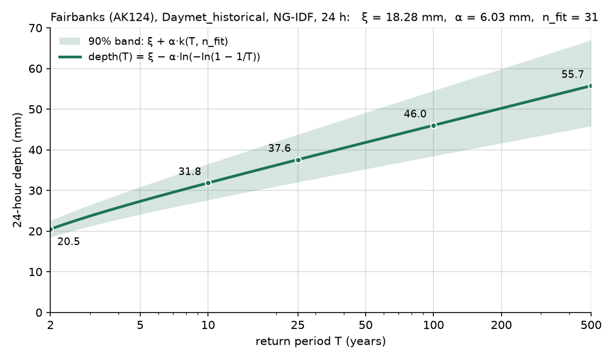

# NG-IDF curation: handoff

_Started 2026-11-23. Living document: update it as the work moves on. Covers the work from 2026-11-16 on._

## 1. What this project does

We precompute **NG-IDF curves** (next-generation intensity-duration-frequency: rain plus snowmelt reaching the ground) and precipitation-IDF curves for the **565 Alaska places** in the SNAP API (`https://earthmaps.io/places/communities`, `region == "Alaska"`). The results are Rasdaman coverages, so the SNAP data API can return a place's curves as numbers.

- **Phase 1 (now):** the 565 places, 12 climate datasets each (Daymet historical, WRF historical/medium/high, CESM2-LE historical and future members LE2/4/7/9), plus CESM near-term windows and ensemble means.
- **Phase 2 (later):** a wall-to-wall 4 km grid.

**Guiding rule: we copy the author's method exactly.** Every scientific choice follows H. Yan's NG-IDF app (PNNL; `hydro-yan/NG_IDF_AWS`, branch `feature/add_spatial_map`, pinned commit `a582a5c`). We call the app's own code (DHSVM, `extract_AM.py`, `get_IDF.R`) and change only what batch running needs. Each change is listed in the README and in the coverage metadata.

## 2. Where everything is

| What | Where |
|---|---|
| Curation code (all science, the pipeline, the QC package) | `github.com/ua-snap/ng-idf_curation`, branch **`prefect-flow`** (not merged to `main` yet) |
| Prefect flow (thin driver) | `github.com/ua-snap/prefect`, branch **`ng-idf-pipeline`**, folder `ng_idf/` |
| The author's app, SNAP mirror | `github.com/ua-snap/NG_IDF` (private), tag `app-a582a5c` |
| Data root (all inputs and outputs) | `/import/beegfs/SNAP/jdpaul3/ng-idf_curation_data/` |
| The flow's clone of the curation repo | `/import/beegfs/SNAP/jdpaul3/ng-idf_curation` (belongs to the flow; don't edit it) |
| Results of each flow run | `$DATA_ROOT/packages/<time>_<model>_<flow run>/`: the QC package (PDF and HTML) and `rasdaman/` (coverage files, inputs table, `wcst_import` recipes) |
| Stage outputs | `$DATA_ROOT/stages/<stage>/<fingerprint>/` |
| Prefect server | `https://prefect.earthmaps.io` (SNAP's production server, Prefect 2.14.13) |
| Raw forcing archive (read-only, 86 TB) | `/import/beegfs/CMIP6/arctic-cmip6/NG-IDL-Full-Forcing/whole_AK_forcing/` |
| The author's own forcing files (read-only; our validation reference) | `/import/beegfs/CMIP6/arctic-cmip6/NG-IDL/` |
| Rasdaman metadata check | clone of `github.com/ua-snap/rasdaman-audit` at `/import/home/jdpaul3/rasdaman-audit` (set in `config/paths.env`) |
| Earlier batch work by B. Torgerson | `/beegfs/SNAP/rltorgerson/Oct-NG-IDF/` (`HANDOFF_2026-11-16.md`); forcing extraction ideas reused, fitting not used |

## 3. Work so far (2026-11-16 to 2026-11-24)

- **Phase 1 built end to end:** place table with the app's own cell rules, forcing for all 12 datasets (WRF/CESM extracted from the 86 TB archive and matching the author's files to the last printed digit; Daymet rebuilt with MetSim), defaults, ~6,700 model runs with the app's code, coverage files and Rasdaman recipes.
- **Defaults follow H. Yan's rules** (his answers of 18 Nov 2026). LAI reproduces his table exactly at 98% of cells; land cover agrees at 97.8%; heights use his new rule and are provisional until he republishes his table.
- **Pipeline with a Prefect flow:** every stage is fingerprinted, so unchanged stages are reused and nothing is overwritten. Each run ends with a QC package (PDF) for H. Yan and colleagues and a `rasdaman/` delivery folder.
- **Findings raised with the author:** short wetland canopies stop DHSVM (15 of our 34 wetland places; 3,253 of the 4,509 wetland cells in his own table under his new height rule); his WRF/CESM script zeroes very wet hours on rain-bucket resets.
- **Pilots (not in production):** running all land within 5 km of a town, and anchoring NG to an observed baseline. Both open.
- **Curves stored as their fit (2026-11-24):** every curve is a 2-parameter Gumbel, so it is fully set by ξ, α and the number of years fitted. A third coverage, `ngidf_places_fit`, stores those, with the formulas and CI table in its metadata (section 5).
- **Flow robustness (2026-11-24):** the flow now stops after 15 failed Slurm queue checks in a row (about 30 minutes) instead of waiting forever; a rerun picks up the running jobs.
- Earlier batch work by B. Torgerson (2026-11-16) supplied the forcing-extraction approach; its fitting step differs from the app's and is not used.

## 4. State right now

- Code: curation `prefect-flow` at `b6613e8`; prefect `ng-idf-pipeline` at `a371f2c`. Both pushed.
- **Latest release: flow run `omega-sakurai-r`** (2026-11-24, curation commit `214e001`): all stages pass, with the known warnings in section 4 of its PDF. Package and Rasdaman delivery folder (three coverages, three recipes): `/import/beegfs/SNAP/jdpaul3/ng-idf_curation_data/packages/20261124_1405_a582a5c_omega-sakurai-r/`. Not yet ingested into Rasdaman.
- Previous release: the first draft (`nu5-lhun-expanse`, 2026-11-23, two coverages); its package is still in `packages/`.
- The data root, the flow's clone and `rasdaman-audit` are shared with the group (set 2026-11-24): group-writable, except `rasdaman-audit`, which is group-readable only.
- All results are **provisional** until H. Yan's soil-temperature DHSVM is out and run.
- The follow-up email to H. Yan was sent on 2026-11-24 (it includes a request for reference runs from his app at 5 points). Waiting for his reply.

## 5. Coverage structure

The product is a set of Rasdaman coverages that the SNAP API serves to the web page. Every curve in them is the result of the NG-IDF app's method (DHSVM, annual maxima, Gumbel fit), run once per release on Chinook. Nothing runs when a user asks for a curve: Rasdaman returns stored numbers, and the SNAP API at most applies one formula.

### Phase 1A (in development): places, one land cover each

Each of the 565 SNAP API places is run with the land cover, LAI and canopy height of its own 1 km cell. Three coverages, all indexed by place:

| Coverage | Holds | Per curve | Used for |
|---|---|---|---|
| `ngidf_places_fit` | Gumbel fit: `xi`, `alpha`, `n_fit` | 3 values | Plot and CSV: the SNAP API computes the curve and its band |
| `ngidf_places` | depth, CI and ensemble range at 51 return periods (2 to 100, and 500 years) | 255 values | Direct lookup; the reference the fit is checked against |
| `ngidf_places_am` | annual maxima: depth, water year, peak date, mechanism, used in fit | 33 years × 5 values | Bar chart of the yearly maxima behind each full-period curve |

`ngidf_places_fit` as xarray shows it (release `omega-sakurai-r`):

```
>>> xr.open_dataset("ngidf_places_fit.nc")
<xarray.Dataset> Size: 2MB
Dimensions:   (location: 565, dataset: 24, variable: 2, duration: 7)
Coordinates:
  * location  (location) int32 2kB 0 1 2 3 4 5 6 7 8 9 ... 555 556 557 558 559 560 561 562 563 564
  * dataset   (dataset) int32 96B 0 1 2 3 4 5 6 7 8 9 10 11 12 13 14 15 16 17 18 19 20 21 22 23
  * variable  (variable) int32 8B 0 1
  * duration  (duration) int32 28B 0 1 2 3 4 5 6
Data variables:
    xi        (location, dataset, variable, duration) float32 759kB ...
    alpha     (location, dataset, variable, duration) float32 759kB ...
    n_fit     (location, dataset, variable, duration) int16 380kB ...
Attributes: (12/19)
    title:                        Gumbel fits behind the NG-IDF and precipitation IDF curves for ...
    fit_method:                   xi and alpha are the L-moment Gumbel fit (lmom samlmu and pelgu...
    curve_formula:                depth_mm(p) = xi - alpha * ln(-ln(p)), where p = 1 - 1/T is the...
    ci_formula:                   ci_lower(p) = xi + alpha * k_lower[n_fit](p) and ci_upper(p) = ...
    ensemble_rows:                Rows named *_ensemble_mean*: xi and alpha are the means of the ...
    ci_k_table:                   {"ci_level_percent": 90.0, "quantiles": [0.05, 0.95], "probabil...
    ...                           ...
    processing_code:              github.com/ua-snap ng-idf_curation commit 214e001e9e739f58bd8a5...
    places_source:                SNAP API, https://earthmaps.io/places/communities, region Alask...
    nodata_locations:             All entries are nodata for AK357 Shemya Station, AK441 Eareckso...
    units:                        mm (depth over the duration); inches = mm / 25.4
    creator:                      Scenarios Network for Alaska and Arctic Planning (SNAP), Univer...
    date_created:                 2026-11-24
```

Index labels are in each axis's `encoding` attribute: `dataset` 0 Daymet_historical, 1–3 WRF historical / medium / high, 4–11 the 8 CESM members (full period), 12–19 the same 8 near-term, 20–23 CESM ensemble means; `variable` 0 P (precipitation), 1 W_veg (NG); `duration` 1, 3, 6, 12, 24, 48, 72 h. Daymet is daily, so its 1 to 12 h entries are nodata.

**From 3 numbers to a curve.** The app fits a 2-parameter Gumbel distribution to each series of annual maxima. That fit is ξ (location, mm) and α (scale, mm), and the whole curve follows from them:

- depth(T) = ξ − α · ln(−ln(1 − 1/T)), for a return period of T years
- 90% band = ξ + α · k(T, n_fit), with k from the table in the `ci_k_table` attribute

The app gets its band by drawing 500 samples from the fitted curve and refitting each one, so the band depends only on ξ, α and the number of years fitted (n_fit: 31 full period, 15 near-term). The k table is that band computed once from a million draws. Ensemble rows hold the mean ξ and α of the 4 members, which gives the app's ensemble mean curve exactly; they have no band, and the member range is the min and max of the 4 member curves. The formulas, the k table and the measured agreement with `ngidf_places` are in the file's attributes, so the SNAP API reads them from the coverage instead of keeping its own copy. The coverage stage fails if any depth or ensemble range rebuilt this way is more than 0.01 mm from `ngidf_places` (the release: 0.0051 mm at most, over 178,438 curves).



The image is drawn from the coverage by `scripts/reports/coverage_fit_figure.py`, the same way the SNAP API would compute it.

### Later phases (to be decided)

| Phase | What | Fit coverage dimensions |
|---|---|---|
| 1B | The same places, run once per land cover, to show how curves change after fire, clearing or development. Unrealistic combinations are nodata | `location: 565, land_cover: 10, dataset: 24, variable: 2, duration: 7` |
| 2A | Every 1 km cell in Alaska, with its own land cover (Alaska Albers grid) | `y: 2035, x: 3727, dataset: 24, variable: 2, duration: 7` |
| 2B | Every 1 km cell, run once per land cover | `y: 2035, x: 3727, land_cover: 10, dataset: 24, variable: 2, duration: 7` |

The 10 land covers are the app's classes: Open, Evergreen, Deciduous, Mixed, Crop, Grass, Shrub, Pasture, Wetland, Moss. The 1 km grid is the extent of NLCD 2016 Alaska, 3,727 × 2,035 cells.

### Sizes on disk (uncompressed)

Rasdaman coverages are rectangular, and nodata cells (ocean, places without a curve, unrealistic land covers) take the same space as data.

| Phase | Shape | Fit coverage | 51-point coverage | Annual maxima |
|---|---|---|---|---|
| 1A | 565 places | 1.9 MB | 194 MB | 44 MB |
| 1B | 565 places × 10 land covers | 19 MB | 1.9 GB | 0.44 GB |
| 2A | 7.6 M grid cells | 25 GB | 2.6 TB | 0.59 TB |
| 2B | 7.6 M grid cells × 10 land covers | 255 GB | 26 TB | 5.9 TB |

Per place or cell: 3.4 kB (fit), 343 kB (51-point), 78 kB (annual maxima). Precipitation (P) doesn't depend on land cover, so the land-cover coverages could store P once and repeat only NG.

A one-page version of this section: https://claude.ai/artifact/CfjChJghKaQ3F4aRMgNwzG (ask Josh for access).

## 6. How to run the pipeline from Chinook and walk away

The flow runs on a Chinook login node inside tmux, registered with SNAP's Prefect server. Once it is started you can disconnect and close the laptop; it keeps running. You watch it at `https://prefect.earthmaps.io`.

### One-time setup

1. **SSH key the flow can use.** The flow logs in to `chinook04` over SSH, even when it already runs there. It needs an RSA private key without a passphrase whose public key is in your `~/.ssh/authorized_keys`. (Josh's is `~/.ssh/id_rsa_new`; his `~/.ssh/id_rsa` is **not** authorized.) To check which of your keys are authorized:
   ```
   cat ~/.ssh/authorized_keys
   ```
2. **Prefect environment** matching the server (Prefect 2.14.13). The two pins are required: newer `griffe` and `pydantic` break Prefect 2.14.
   ```
   conda create -y -n prefect2 -c conda-forge python=3.11 prefect=2.14.13 paramiko "griffe<1.0" "pydantic<2.11"
   ```
3. **Prefect repo** on the `ng-idf-pipeline` branch:
   ```
   cd ~
   git clone https://github.com/ua-snap/prefect.git
   cd ~/prefect
   git checkout ng-idf-pipeline
   ```
4. **Point Prefect at SNAP's server** (stored in `~/.prefect/profiles.toml`):
   ```
   conda activate prefect2
   prefect config set PREFECT_API_URL=https://prefect.earthmaps.io/api
   ```
5. **If you are not `jdpaul3`: commands to run once in your own account.** The data root and the flow's clone belong to `jdpaul3` and are shared with your group (group-writable; the pipeline keeps new files that way). Two things still have to be set on your side:
   ```
   git config --global --add safe.directory /import/beegfs/SNAP/jdpaul3/ng-idf_curation
   git config --global --add safe.directory /import/home/jdpaul3/rasdaman-audit
   ```
   - **Why the first:** the flow updates its clone of the curation repo with git at the start of every run. Git refuses to work in a repository owned by another user ("detected dubious ownership") unless you mark it as safe, so the flow would stop at its first step.
   - **Why the second:** the coverage stage reads the version (git commit) of the Rasdaman metadata check from that clone and makes it part of the stage's fingerprint. If git refuses, the version reads as "missing", the fingerprint changes, and the coverage stage reruns under your account even though nothing changed.
   - Also needed: your own SSH key (step 1), the `prefect2` environment (step 2), and the Prefect server setting (step 4). Set `ssh_username` and `ssh_private_key_path` to yours when you start a run.
   - Only if the app stage reruns (a new model version): a GitHub credential that can read the private `ua-snap/NG_IDF`.

### Each time

```
ssh <you>@chinook04.rcs.alaska.edu
tmux new -s ngidf
conda activate prefect2
cd ~/prefect
git pull
export PYTHONPATH=$PWD
python ng_idf/ngidf_pipeline.py
```

When it says the flow `ng-idf-pipeline` is being served, start a run from the Prefect web page: **Deployments → ng-idf-pipeline → Run → Custom run**. Name the run (the name appears on the PDF cover) and set:

| Parameter | Value |
|---|---|
| `branch_name` | `prefect-flow` (a branch of the **curation** repo, not the prefect repo) |
| `ssh_username` | your Chinook user |
| `ssh_private_key_path` | your key from step 1, as a full path |

Leave the others at their defaults unless you need them (see the table in `ng_idf/README.md`). Or start it from a second tmux window (Ctrl-b, then c):
```
conda activate prefect2
prefect deployment run 'ng-idf-pipeline/ng-idf-pipeline' --param branch_name=prefect-flow --param ssh_private_key_path=/home/<you>/.ssh/<key>
```

Then **detach with Ctrl-b, then d**, log out, and close the laptop.

### Coming back

```
ssh <you>@chinook04.rcs.alaska.edu
tmux attach -t ngidf
```
The tmux session exists on `chinook04` only, so log in to that node by name. Stop serving with Ctrl-c when you are done.

### What a run does and how long it takes

The flow clones or updates the curation repo, plans which stages need to run, submits them to Slurm, waits, checks each stage's results, and finally builds the QC package. Unchanged stages are reused in seconds. A full rerun of the ~6,700 model runs takes about an hour on 8 nodes when the queue is quiet; places, coverage and QA take a few minutes each. Results land in `$DATA_ROOT/packages/<time>_a582a5c_<run name>/`.

### Problems we hit, and the fixes

| Symptom | Cause | Fix |
|---|---|---|
| `ModuleNotFoundError: No module named 'utils'` | `PYTHONPATH` set on its own line without `export` | `export PYTHONPATH=$HOME/prefect` before `python` |
| `422 Unprocessable Entity ... 'labels' ... extra fields not permitted` | Prefect 3 client talking to the Prefect 2.14 server | Use the `prefect2` environment |
| `No module named 'griffe.dataclasses'` | `griffe` 1.0 or later with Prefect 2.14 | Install `"griffe<1.0"` and `"pydantic<2.11"` |
| Run stops making progress after the laptop sleeps | The flow ran on the laptop | Run it from Chinook in tmux, as above |
| Flow run failed with "Gave up after 15 failed Slurm queue checks in a row" | Slurm's controller or the SSH connection stopped answering for about 30 minutes (15 checks, `max_queue_failures`, at the 120 s `poll_seconds`) | The jobs were not cancelled. Start a new run with the same parameters: it waits for the jobs already submitted instead of submitting new ones, and reuses everything finished |
| A stage's Slurm jobs finished but the flow never moved on | The flow lost its connection and kept waiting (before the flow gave up on failed queue checks) | Cancel the flow run and start a new one with the same parameters. It reuses everything finished and picks up the jobs already submitted; nothing is lost |
| `the clone has local edits` | Someone edited the flow's clone | Commit or discard the edits in `/import/beegfs/SNAP/jdpaul3/ng-idf_curation` |

## 7. The QC package (PDF)

Built at the end of every flow run. Its text lives in the curation repo:

| Section | Source |
|---|---|
| 1. Overview | `ngidf/package/content/overview.md` |
| 4. Known issues | `ngidf/package/content/known_issues.md` (one `## ` heading per issue; a check written as `` `stage` / `check name` `` shows its result from the run) |
| Appendix A. Inputs | `ngidf/package/content/appendix_inputs.md` |
| Appendix C. Fingerprints text | `ngidf/package/content/fingerprints.md` |
| Step descriptions, tables, layout | `ngidf/package/build.py` |
| Stage descriptions and check texts | `ngidf/pipeline.py` |

Editing the Markdown files or `build.py` re-runs nothing; changing a stage's checks re-runs QA only. To preview a PDF from your working tree:
```
python3 -I ngidf/pipeline.py package --out-dir ~/tmp/pkg --python /import/beegfs/SNAP/jdpaul3/ng-idf_curation_data/envs/report_pdf/bin/python
```
A flow run uses the text only after it is committed and pushed.

**Comparison with a previous release.** Turned off for the first draft (`BASELINE_COVERAGE_DIR` is empty in `config/model_versions/a582a5c.env`); the PDF then has no section 3.8. Set a baseline for later model versions (for example the soil-temperature DHSVM) to get the comparison back.

## 8. Open items

**Waiting on H. Yan**
- Reply to the follow-up email (sent 2026-11-24: the wetland count, the bucket-reset bug, LAI and height for land-cover scenarios, the WRF humidity question, moss, the elevation file, and a request for reference runs at 5 points).
- LAI and height to use when a place's land cover is changed (needed before curves for other land covers can be added).
- Wetland canopies below 0.775 m: his choice of fix (floor the height at 0.78 m, or run as open, or other).
- His republished defaults table: check our heights against it.
- Moss: DHSVM class, LAI and height.
- The soil-temperature DHSVM (end of 2026): add a model version, rerun everything, compare with the first draft.
- Reference outputs from his app: once they arrive, the reference stage compares them value by value (only that stage reruns).

**Ours**
- Ingest the three coverages of `omega-sakurai-r` into SNAP's Rasdaman server (separate step on that server), with the recipes in its `rasdaman/` folder.
- SNAP API endpoint for NG-IDF: read `ngidf_places_fit`, compute depth and CI with the formulas and k table in its metadata, and serve JSON for the web page's plotly charts and a CSV download (section 5).
- Phase 1B prep: a `land_cover` axis in the coverage builder and a per-place land-cover override in the runs, so that only the LAI and height rule waits on H. Yan.
- Optional: count rain-bucket reset hours affected in our cells (Slurm job, about 76 GB of reads), if H. Yan asks how often it happens.
- Merge `prefect-flow` and `ng-idf-pipeline` into `main` once the first draft is accepted.
- Open questions: running the land around each town (zones), forest damping of snowmelt at Juneau, anchoring to an observed baseline (delta method), Phase 2 wall-to-wall design (1 km; compute is about 18 M DHSVM runs for 2A).
